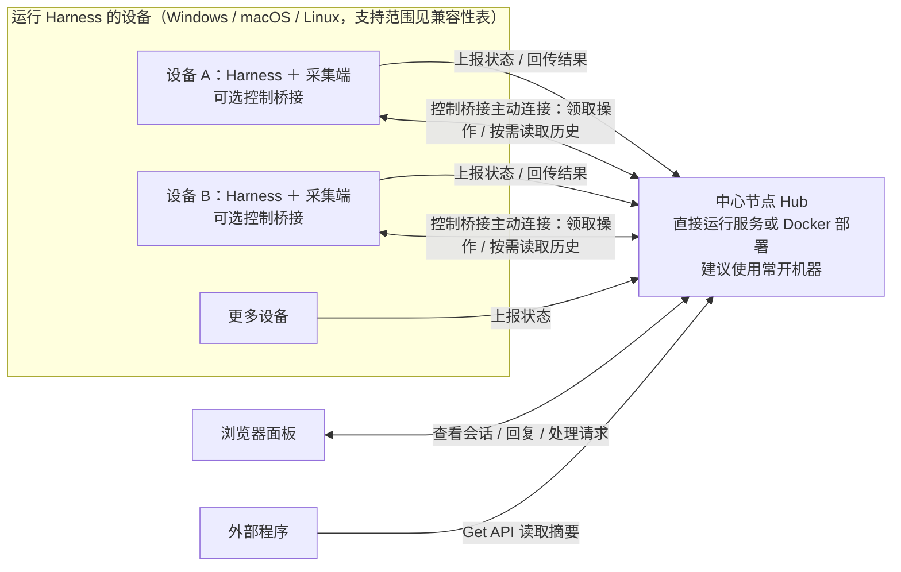

# Agent Watch

监控多台电脑上的 Antigravity / DeepSeek Harness / Codex 任务状态：**哪个任务在跑、跑了多久；哪个刚做完、哪个卡住了需要介入**。

实验性原会话交互正在开发，当前能力、接入限制和验证范围见 [原会话交互说明](NATIVE_INTERACTIONS.md)。普通采集不会自动取得回复或审批权限。

各操作系统、客户端和功能的已验证/未验证组合见 [兼容性与验收矩阵](COMPATIBILITY.md)。回复框下方分别提供模型、推理强度和权限下拉，打开时选中原应用报告的当前值，未知字段不猜测。Codex 权限按原生三项显示；受限制或尚未确认可用的选项保持禁用并说明原因。Antigravity 权限作用于整个项目；DeepSeek 权限作用于当前会话，其模型切换还会更新后续默认模型，应用前会确认这一范围。选项均来自原生能力。新建入口在会话列表顶部，标明目标设备、Harness 和目录或项目；Codex 桌面版打开原生预填草稿，需在 Codex 中确认发送。

运行中回复默认等待当前轮结束。等待列表可取消；在已确认支持原生插入的 Codex、DeepSeek 会话中，可明确选择“立即插入”。Antigravity 暂不提供插入。面板等待队列与原应用自身队列有区别：等待中的消息还未交给原应用，最多保留 24 小时、每会话 20 条；失联或结果未知不会自动重发。Enter 提交，Shift + Enter 换行。

## 中心化网络与部署拓扑

Agent Watch 采用中心化网络：**一个中心节点（Hub）汇总各设备的会话状态，提供统一的查看、回复与处理入口**。建议将中心节点部署在常开机器上，可以直接运行服务，也可以使用 Docker 部署。

每台运行 Harness 的设备安装采集端，读取本机原生会话并向中心节点上报。需要在面板回复或处理请求时，再配置该设备的控制桥接。浏览器可以从任意可访问中心节点的设备打开，不需要安装采集端。中心节点所在机器也可以同时运行 Harness 和采集端。



各设备主动连接中心节点；中心节点不直接读取其他设备的本地文件，也不代替原生 Harness 运行 Agent。设备离线时保留最后上报的状态，但不能进行实时交互。回复、审批和历史读取的可用范围取决于对应设备与 Harness 的适配情况。

## 1. 部署中心节点

### Docker 部署

```bash
git clone https://github.com/xuhuaya0/agent-watch.git
cd agent-watch
docker compose up -d
```
- 首次打开 `http://<中心节点IP>:8090/` 时，页面会引导你**初始化管理员密码**（也可通过环境变量 `AGENT_WATCH_PASSWORD` 预设）。
- 首次启动会自动生成两个独立的随机 Token（可在登录后点右上角 **「⚙ 设置」** 查看或一键重置）：
  - **本机接收令牌 `ingest_token`**：主控接收数据时校验的凭据。复制到各采集电脑的“上报令牌”，不要覆盖采集电脑自己的接收令牌。
  - **`summary_token`**：只读 Token，供外部程序读取 `/api/get?token=<summary_token>` 使用，无需模拟网页登录。

### 在机器上直接运行服务

安装 Python 后，在项目目录运行：

```sh
python -m pip install flask zstandard
python hub.py
```

默认监听端口为 `8090`，浏览器访问 `http://<中心节点IP>:8090/`。请使用系统服务管理器保持进程运行；配置、设备身份和任务数据需要持久保存。Docker 部署使用挂载的数据目录，直接运行默认使用项目配置和 `data/`。

---

### 将设备连接到中心节点

1. 在中心节点设置的“Push 接收”区域，复制“本机接收令牌”。
2. 在采集电脑设置的“Push 上报”区域，填写中心节点地址，将复制的值粘贴到“上报令牌”并保存。
3. 中心节点的 `ingest_token` 应等于采集电脑的 `hub_token`。采集电脑自己的 `ingest_token` 是另一用途，不需要相同。

旧配置中如果已经填写 `hub_urls`、但没有 `hub_token` 字段，升级时会沿用原有共享令牌作为上报令牌，保存设置后固定为独立字段。清空上报令牌不会回退到本机接收令牌。重置本机接收令牌不会改变上报令牌。

会话列表按原 Harness 的 Pinned / Recent 分组；状态筛选提供“需介入、进行中、刚完成（2h 内）、近期会话（2–12h）、其他”。正在运行及未处理的注意事项保留在前两组；其余会话按时间分组，点击“知道了”不改变所属时间区间。满 2h 进入近期会话，满 12h 进入其他，缺少时间的记录归其他。

完成/空闲会话采用状态结束时间，活动任务采用最近事件时间，避免日志整理等后续事件把旧完成任务推成新任务。Recent 按该时间从新到旧排序；主机与 Harness 使用独立标记，同名电脑按设备 ID 保持分开。Get 精简摘要聚焦需介入、进行中及未确认的 2h 内会话，完整历史通过 `/api/tasks?all=1` 读取；默认 `include_all_sessions: true` 采集所有可用主会话，包含旧会话，排除 Harness 原生已归档会话；设置为 false 才使用 `lookback_days`。Codex 有原生索引但缺少正文日志时，保留索引条目并明确标注；仍不代表完整对话备份。

## 2. 安全与认证机制

- **内置登录页**：PBKDF2-HMAC-SHA256（20 万次迭代 + 随机盐）存储管理员密码；支持勾选「记住登录（30 天免密）」、退出登录、在线修改密码。
- **全业务接口保护**：`/api/tasks`、`/api/tasks/<key>/ack`、`/api/settings`、`/api/machines/<m>` 等业务接口全部强制检查管理员会话，未登录一律返回 `401`。
- **双 Token 职责隔离**：
  - 采集器推送 `POST /api/push` 仅校验 `Authorization: Bearer <ingest_token>`。
  - Get 读取接口 `GET /api/get` 支持已登录会话 **或** 只读 Token（`?token=<summary_token>` / `Authorization: Bearer <summary_token>`）。
- **基础安全防护**：
  - **登录失败限速**：同一 IP 连续失败 5 次自动锁定 5 分钟（返回 `429`）。
  - **会话过期与改密失效**：修改管理员密码会自动递增密码版本号并轮换签名密钥，**所有设备上的旧会话立即全部失效**。
  - **CSRF 防护**：所有管理员写操作接口（`POST` / `DELETE`）强制校验 `X-CSRF-Token` 请求头与当前会话令牌匹配。

---

## 3. 在 Windows / Mac 上一键启动与驻留图标

- **Windows**：双击 [`start_win.vbs`](start_win.vbs)（无黑框）或 [`start_hub.bat`](start_hub.bat)，右下角系统托盘出现状态图标（橙=需介入、蓝=运行中、绿=刚完成、灰=空闲）。
- **macOS**：本机生成应用后，在 Finder 中双击 [`Agent Watch.app`](Agent%20Watch.app)，只驻留顶部菜单栏，不打开终端、不显示 Python Dock 图标。应用包需与 `tray.py` 保持在同一项目目录中；可给应用创建替身放到桌面。首次启动会创建 `.venv` 并安装依赖，失败时弹窗提示日志位置。从源码首次使用时先运行 `bash build_mac_app.command`（需安装 Apple Command Line Tools；应用二进制不入库）。已有的 [`start_mac.command`](start_mac.command) 仍可用于从终端启动和排查问题。
- **开机自启**：在托盘图标右键菜单直接勾选 **「☑ 开机自动启动」**，或在网页「⚙ 设置」中勾选保存即可。
- **WireGuard 单机多 IP & 离线保留**：在「⚙ 设置」的「远端主控 Hub 地址」中可同时填写中心节点的局域网 IP 和 WireGuard IP（一行一个），自动择优推送；某台电脑关机下线后，其最后任务状态会一直保留并标注 `机器离线 Xm`。
- 托盘端每 5 秒扫描并尝试推送，优先使用上次成功的地址；失败后尝试下一个地址（每个地址默认最多等待 4 秒）。纯命令行 `collector.py` 的默认间隔是 10 秒。切换不是毫秒级保证。
- 同一安装的设备 ID 保持不变，局域网和 WireGuard 地址归到同一台设备下。

### 设备身份与升级

- 每个安装首次启动会生成 UUID，保存在配置文件旁的 `config.json.machine-id`。Docker 中位于挂载的数据目录 `/app/data/config.json.machine-id`，因此重建容器不会改变身份。配置所在目录需可写；也可在只读配置中显式设置 `machine_id` UUID。
- `machine` 是显示名称；改名不改变任务 ID 或已查看状态。不同设备同名时，界面显示短设备 ID 以便区分。
- **先升级 Hub，再升级所有采集器**。旧采集器不发送设备 ID，仍按名称识别；旧客户端同名冲突只有升级后才能解决。
- 旧的按名称保存的记录和新 UUID 记录会并存，系统不会仅凭名称自动合并。确认新设备正常上报后，可在登录后的机器卡片上删除旧记录；旧记录的已查看状态不会自动迁移。
- 将配置复制到另一台电脑时，不要复制 `*.machine-id`，并删除配置里的 `machine_id` 字段，让新安装生成自己的 ID。备份恢复到同一台设备时则应保留它。
- 设备 ID 用于区分设备，不是认证凭据；本版本仍使用现有的共享推送 Token。

---

## 4. 通用 Push / Get 接口

- **`POST /api/push`**：上报本机任务快照，使用 `Authorization: Bearer <ingest_token>`；采集端的 `hub_token` 填目标主控的该令牌。
- **`GET /api/get`**：按优先级排序的精简 JSON（含每台机器在线/离线状态 `machines`），支持 `If-None-Match` 请求头与 `?since=<hash>` 参数（比对响应头 `X-Summary-Hash`），内容未变时返回 `304 Not Modified`。
- **`GET /api/tasks?all=1`**：任务列表和工作台偏好，不包含较长的最近一轮正文。
- **`GET /api/tasks/<url_encoded_key>`**：所选会话详情，包含采集到的最近一轮内容。
- **`PATCH /api/workspace/tasks/<url_encoded_ui_key>`**：更新面板已读状态（独立置顶写入返回 409），需要管理员会话及 CSRF；使用列表返回的 `ui_key`。
- **`POST /api/tasks/<url_encoded_key>/ack`**：标记「已查看」。
- **`GET / POST /api/settings`**：读取或修改本机设置（含开机自启、多 IP Hub 列表、工具开关、Webhook）。
- **设备标识**：新客户端在 `/api/push` 顶层发送 `machine_id` UUID。`machines` 对象以 `id:<UUID>` 为键，显示名从对象内的 `machine` 字段读取；旧客户端仍以名称为键。任务 `key` 为 `id:<UUID>/<tool>/<session_id>`（旧格式仍可用）。确认/删除接口应使用 API 返回的键，不要自行按显示名拼接。
- 上述接口仍遵循第 2 节的认证规则：摘要需要管理员会话或只读 Token，管理接口需要管理员会话，写操作另需 `X-CSRF-Token`。

旧版接口路径继续作为兼容入口，现有 Token 无需更换。新版采集器优先使用 `/api/push`，连接旧版主控遇到 404/405 时回退到旧版上报入口。

## 会话工作台

- **会话**使用导航 / Pinned 与 Recent 列表 / 详情三栏。列表可拖动调整宽度、收起；手机使用列表与详情切换。搜索、项目、主机、Agent、状态/时间条件可组合筛选。
- **项目、设备、设置**使用导航与内容两栏。项目按设备与工作目录区分；没有完整路径时按采集器提供的项目名归类，不自动合并跨主机同名项目。当前尚未接入各 Harness 的原生项目管理或 Git 根目录识别。
- Pinned 只使用采集端上报的 `extra.native_pin`。Codex 读取当前桌面全局置顶列表（包括明确的空列表），无此字段时读取数据库 `is_pinned`；DeepSeek Harness 读取 `storages/workspace.json` 的 `global.pinnedSessionIds`。不支持或旧版采集端标记为未知，不沿用面板旧置顶。
- Antigravity 桌面版读取用户数据目录 `app_storage.json` 的 `pinned_conversations_order`，保留原生顺序。Windows 在 `%APPDATA%/Antigravity`，macOS 在 `~/Library/Application Support/Antigravity`，Linux 在 `$XDG_CONFIG_HOME/Antigravity`（默认 `~/.config/Antigravity`）；非标准安装可配置 `adapters.antigravity.sidebar_path`。旧版或缺失字段仍为未知，不视为未置顶。
- 当前置顶只读，请在原 Harness 中修改后等待采集刷新。面板没有独立置顶按钮，后端也拒绝独立置顶写入，避免假同步。
- 面板只在 Hub 的 `data/workspace.json` 保存已读状态，跨浏览器同步并使用稳定会话 ID。没有面板独立归档或隐藏功能；升级时自动清除旧的面板归档标记，保留已读时间。原 Harness 的会话和归档状态不会被修改。Codex、Antigravity、DeepSeek Harness 原生归档后均从面板列表、搜索、计数与交互入口隐藏，取消归档后在下一次采集恢复。Antigravity 使用 `conversation_summaries.db` 原生搜索索引的会话头（`chunk_index=-1`）读取归档标记，不能使用正文块或旧标题文件判断；已有索引无法读取时显示采集错误并暂停该 Harness 的会话控制。旧版缺少索引时归档状态未知，需要升级原应用才能同步。
- 列表定时轻量刷新，详情按需获取。切换会话记住阅读位置，刷新保留选中项及子 Agent 展开状态；已读与“知道了”分别表示阅读进度和状态确认。
- 新采集端传送最近用户消息（最多 32,768 字符）和当前轮最新回复（最多 65,536 字符），超限明确提示。支持安全的标题、粗体、列表、代码块及复制，原始 HTML 不执行。三种 Harness 的工具调用和有原生阶段标记的过程说明默认折叠；最终回答直接显示，刷新保留手动展开状态。旧客户端仍可使用，详情显示已有摘要。Codex、Antigravity、DeepSeek 的文字与工具历史支持按需分页读取，附件仅显示占位，不传输原始文件。Antigravity 与 DeepSeek 的 Windows 分页读取及中心节点转发已验证，旧版控制端需要更新。原会话回复需另行配置原生桥接，当前实机验证范围及限制见 [NATIVE_INTERACTIONS.md](NATIVE_INTERACTIONS.md)。

## 识别范围与限制

- **Codex**：保持默认关闭，需在设置中启用。支持旧式 `user_message` 及新版 `response_item` 用户消息、工具调用/结果；未写完的 JSONL 尾行不会使已有任务消失。带调用 ID 的审批按对应结果解除，旧式无 ID 审批只能以随后工具结果作为恢复信号。Mac 的消息、开始、完成事件已对照真实日志；审批变体仍需各客户端版本的真实日志验证。标题优先使用 Codex 本地数据库中的显示名称（`name`），其次读取 `session_index.jsonl` 的会话名及旧版本数据库标题；数据库只读访问且允许缺失或锁定。无名称可用时才以日志标题或第一条实际用户请求兜底，不把最后一句回复作为标题。附件和环境包装文字会从消息摘要中剥离，修改会话名后下次扫描即可更新。按明确的 `source.subagent` / `parent_thread_id` 元数据将工作子 Agent 归并到主会话，界面默认折叠、按需展开；普通用户分叉会话仍独立显示。过滤 `guardian` / `guardian_review` 内部辅助会话及仅含初始化记录的日志。缺失状态时间时使用真实活动时间，再兜底文件修改时间，不使用扫描时刻；设置和压缩记录不会刷新活动时间。子 Agent 的父日志超过扫描窗口时仍会按需加载；父日志缺失的子 Agent 不会冒充主会话，待父日志可用后自动归并。不会推测日志中未记录的提问/审批。
- **Antigravity**：项目路径识别支持 Windows 用户目录、macOS `/Users`、Linux `/home` 和 `/root`。后台任务按 ID 识别完成通知和 `manage_task` 的取消成功结果；取消请求、失败结果或日志引用不会清除待完成状态。未收到结束记录的后台任务超时后标为“疑似卡住”，不会因超时判定完成。`BypassSandbox` 等待批准仍是启发式推测。
- **DSH**：递归汇总活动父任务的子代理注意状态，按优先级选择，并保留触发该状态的时间；支持循环关系和缺失日志的保护。完成/取消的父任务不会被历史子代理重新激活，子代理状态仍保留在 `extra.subagents` 中。
- 回归测试包含合成边界样例及参照真实格式编写的脱敏结构样例，不等于所有系统、所有客户端版本的实机兼容认证。Windows/macOS 托盘、自启动和各 Agent 的原生 UI 仍需实机验收。

## 测试
```powershell
python -m pip install flask zstandard
python -m unittest discover -s tests -v
```

GitHub Actions 在 Windows、macOS、Linux 上分别运行 Python 3.11 和 3.13 的回归测试。

### 测试数据隔离

Hub 接口测试通过 `tests/hub_fixture.py` 创建临时配置、认证和任务存储，并在首次导入 Hub 前指定 `AGENT_WATCH_DATA_DIR`。回归测试不会向日常 `data/` 写入样例设备。实际运行可通过 `AGENT_WATCH_DATA_DIR` 显式指定任务与认证数据目录；默认仍为项目 `data/`。
